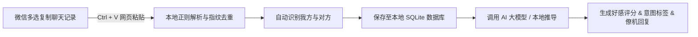

<div align="center">

# 💬 WeChat AI Crush Analyzer
### 微信聊天记录 AI 好感度分析与高情商恋爱僚机工作台

一个极简、私密、现代化的全栈 Web 应用，支持在微信中多选复制聊天记录后一键粘贴导入，基于大语言模型深度剖析沟通潜台词、实时测算好感度，并提供多策略的高情商僚机参考回复。


</div>

---

## 🌟 核心特性

- ⚡ **无感导入与指纹去重**：无需上传文件，在微信中多选复制聊天记录后，直接在网页按下 `Ctrl + V` 即可瞬间解析；采用 `(发言人+时间戳+正文)` 指纹算法，重复粘贴自动过滤，仅合并增量消息。
- 🔍 **微信多格式高容错识别**：自研正则状态机引擎，完美兼容微信桌面端（PC/Mac 单行消息头、两行消息头）、移动端合并转发、中括号格式，并鲁棒兼容特殊表情符与 Emoji 昵称。
- 💭 **单句微观心理学拆解 (Micro-Analysis)**：
  - **对方气泡**：实时标注 `表层情绪`（轻松/撒娇/试探）与 `深层意图`（主动报备/寻求认同/刺激注意），点击气泡可展开详细的心理学潜台词洞察。
  - **我方气泡**：提供 `发言得失点评` 与沟通学建议，帮助复盘自身发挥。
- 💖 **全维好感度仪表盘 (Affection Meter)**：顶部极简指示条实时呈现 `0~100` 好感度量化分值及关系阶段（如：*高甜暧昧期*、*破冰拉扯期*、*情绪依赖期*），点击可展开深度全维研判报告抽屉。
- 🎯 **高情商僚机参考回复**：针对对方最新动态，实时生成 3 种策略风格的参考回复（**顺水推舟/推进**、**幽默推拉/调侃**、**制造好奇/留白**），支持一键点击复制到剪贴板。
- 🗄️ **类似 Gemini 的多会话 SQLite 存储**：内置轻量级 SQLite 数据库（WAL 高性能模式），支持创建新会话、切换历史分析、修改标题与删除，聊天记录完全持久化在本地。
- 🔒 **隐私至上与服务端隔离**：所有大模型 API Key 统一在服务端 `.env` 文件中管控，前端绝不暴露任何凭据；内置本地启发式推导保底引擎，即使不配置 API Key 亦能开箱即用。

---

## 🛠️ 技术栈架构

| 模块 | 技术选型 | 说明 |
| :--- | :--- | :--- |
| **全栈框架** | **Next.js 16 (App Router)** | 前后端同构，内置 Turbopack 毫秒级热更新，原生 Route Handlers |
| **视图层** | **React 19 + TypeScript** | 严格类型定义，组件化响应式架构 |
| **样式体系** | **Tailwind CSS v4** | 仿原生微信极简低饱和度配色、精致阴影与动效 |
| **数据库** | **SQLite (better-sqlite3)** | 服务端本地轻量级持久化，WAL 高并发模式 |
| **图标库** | **Lucide React** | 现代化极简线性图标 |
| **AI 引擎** | **OpenAI Compatible API** | 原生兼容 DeepSeek、Moonshot Kimi、OpenAI、通义千问等主流大模型 |

---

## 🚀 快速上手

### 1. 克隆项目并安装依赖

确保本地已安装 Node.js (推荐 v18+ 或最新 LTS 版本)：

```bash
# 克隆仓库
git clone https://github.com/your-username/wechat-ai-analysis.git
cd wechat-ai-analysis

# 安装依赖
npm install
```

### 2. 配置大模型环境变量（可选）

项目根目录下已准备好配置文件模板。系统支持任何兼容 OpenAI 格式的模型接口（如 **DeepSeek**、**Kimi**、**GPT-4o** 等）。

复制配置文件：
```bash
cp .env.example .env.local
```

编辑 `.env.local`，填入你的 API Key：
```ini
# 大模型 API Key（留空则自动使用内置本地推导引擎）
AI_API_KEY=sk-xxxxxxxxxxxxxxxxxxxxxxxx

# 接口 Base URL（默认为 DeepSeek 官方接口）
AI_BASE_URL=https://api.deepseek.com/v1

# 模型名称
AI_MODEL=deepseek-chat
```

> 💡 **提示**：未配置 API Key 时，系统会自动使用内置的**本地高精度心理学启发式推导引擎**，开箱即可体验完整流程！

### 3. 启动开发服务器

```bash
npm run dev
```

打开浏览器访问 [http://localhost:3000](http://localhost:3000)。

---

## 📖 使用指南



1. **导入聊天**：
   - 在微信 PC 端或手机端，长按/框选多条聊天记录并点击 **“复制”**；
   - 打开本 Web 页面，直接按下快捷键 **`Ctrl + V`**（或点击右上角 **`+`** 号手动导入/读取剪贴板）；
   - 系统将自动清洗文本、识别发言人并以绿色（我方）与白色（对方）气泡回显。
2. **身份确认与对调**：
   - 顶部导航栏会自动标明当前判断的我方和对方名字；
   - 若系统默认推断与实际角色相反，点击顶部的 **`[⇄ 对调身份]`** 按钮即可一键调换左右视角并重新推演。
3. **查看微观洞察与报告**：
   - 对方每句气泡下方会自动生成 `情绪` 与 `意图` 标签；点击任意气泡可查看详细的心理学潜台词深度剖析；
   - 点击顶部居中的 **好感度指标**，可展开全维分析报告抽屉。
4. **使用参考回复**：
   - 底部状态栏会展示 3 种不同沟通策略的回复卡片，点击任意卡片即可直接复制到剪贴板，随后前往微信粘贴发送。
5. **多会话管理**：
   - 点击最左侧边栏的 **聊天图标**，可展开历史记录列表；
   - 支持类似 Gemini / ChatGPT 的会话管理：自由新建分析、切换不同聊天、重命名会话标题或删除历史记录。

---

## 📂 项目目录结构

```text
AnalysisWechat/
├── data/                      # SQLite 本地数据库文件目录 (已被 gitignore 忽略)
│   └── wechat_chat.db         # 本地持久化数据库文件
├── src/
│   ├── app/
│   │   ├── api/
│   │   │   ├── analyze/       # AI 聊天分析与好感度推演接口
│   │   │   └── sessions/      # SQLite 多会话 RESTful API (增删改查)
│   │   ├── globals.css        # 全局样式与仿微信极简主题色
│   │   ├── layout.tsx         # 根布局与元数据配置
│   │   └── page.tsx           # 主工作台页面 (状态联动与全局快捷键捕获)
│   ├── components/
│   │   ├── Header.tsx         # 顶部状态栏、好感度进度条、对调身份操作
│   │   ├── Sidebar.tsx        # 最左侧极简导航图标栏
│   │   ├── SessionList.tsx    # 类似 Gemini 的历史会话列表侧栏
│   │   ├── ChatMessageList.tsx# 仿微信气泡消息流与微观情绪标签
│   │   ├── FooterBar.tsx      # 发挥评分、下一步行动指引、参考回复卡片
│   │   ├── AnalysisDetailDrawer.tsx # 好感度深度研判报告抽屉
│   │   ├── MessageDetailModal.tsx   # 单句气泡心理学深潜弹窗
│   │   ├── PasteModal.tsx     # 手动导入与测试预设弹窗
│   │   └── SettingsModal.tsx  # 角色归属与偏好设置
│   ├── lib/
│   │   ├── db.ts              # SQLite 数据库初始化与数据操作封装
│   │   ├── parser.ts          # 微信剪贴板正则清洗与指纹去重算法
│   │   ├── ai-analyzer.ts     # 恋爱心理学 Prompt 组装与大模型调用
│   │   └── sample-data.ts     # 真实场景测试示例数据集
│   └── types/
│       └── chat.ts            # 数据模型接口定义
├── .env.example               # 环境变量配置模板
└── next.config.ts             # Next.js 与 Turbopack 编译配置
```

---

## 🛡️ 隐私与安全说明

- **本地离线优先**：微信聊天记录的格式化、解析、指纹去重均在浏览器端直接执行，敏感文本无需经过任何非授权的第三方代理；
- **自持数据库**：会话持久化存储仅存放在你本地机器的 `data/wechat_chat.db` SQLite 文件中，绝不上传云端第三方数据表；
- **服务端凭据隔离**：大模型 API Key 仅保留在服务器本地 `.env.local` 中，客户端无法获取。

---

## 📄 开源许可证

本项目基于 [MIT 许可证](LICENSE) 开源。欢迎 Star、Fork 或提交 Pull Request！
